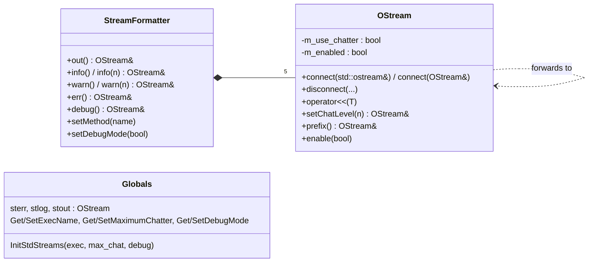

# st_stream Architecture

**st_stream** is a tiny library (three source files) that gives the
Fermitools a uniform way to write terminal output. It provides
`std::ostream`-like `OStream` objects that can fan out to several
destinations, can be switched off by a global *chatter* threshold, and can
carry a message prefix such as `gtbin: WARNING: `. Most C++ code in the tools
writes through a `StreamFormatter` rather than `std::cout`.

The Doxygen mainpage (`src/mainpage.h`) is mostly accurate, but it says
`info()` goes to `stlog`. Since v0r5 (2007) it goes to `stout`; the header
comment in `StreamFormatter.h` repeats the old claim. Use the code as the
source of truth.

## Purpose and scope

**Does:**
- Provide three global streams, `st_stream::sterr`, `stlog` and `stout`,
  that forward to `std::cerr`, `std::clog` and `std::cout` once initialised.
- Provide `OStream`, a stream that forwards `<<` output and format state
  (`precision`, `width`, `flags`, `fill`, …) to any set of `std::ostream`s
  and other `OStream`s.
- Hold process-wide settings: executable name, maximum chatter, debug mode.
- Provide `StreamFormatter`, which bundles five purpose-specific streams
  (`out`, `info`, `warn`, `err`, `debug`) with standard prefixes and
  chatter rules.

**Does not:**
- Read the `chatter`/`debug` parameters. `st_app` does that and pushes the
  values in (see `src/st_app/doc/architecture/`).
- Write log files, add timestamps, or buffer. Redirecting output means
  calling `connect`/`disconnect` on the global streams yourself.
- Prepend prefixes automatically. The caller must ask for a prefix on each
  line (see [gotchas](#invariants-and-gotchas)).
- Provide thread safety. All state is unsynchronised globals.

## Position in the system

| Direction | Package | Why |
|-----------|---------|-----|
| Depends on | — | No Fermi or external dependencies; only the C++ standard library. `CMakeLists.txt` has no `target_link_libraries` for the library. |
| Used by | `st_app` | `IStAppFactory::configureApp` connects the global streams and sets exec name, chatter and debug mode from the par file. `StApp::banner` writes through a `StreamFormatter`. |
| Used by | Nearly every tool package | `StreamFormatter` is the standard output object of tool classes. Heaviest users: `Likelihood` (~46 files), `SolarSystemTools`, `dataSubselector`, `timeSystem`, `orbitSim`, `map_tools`. |
| Used by | `st_facilities` | Public header `st_facilities/Timer.h` holds a `StreamFormatter`. `st_facilities` does **not** link `st_stream` in CMake; it gets it transitively through its clients. |
| Used by | `st_graph` | GUI classes report errors through a `StreamFormatter`. |
| Used by | `pyLikelihood` | `LogLike.initOutputStreams(maxChatter)` (SWIG `%extend`) calls `OStream::initStdStreams()` and `SetMaximumChatter`, so Python sessions can see library output. |
| Used by | `timeSystem` | `PulsarTestApp` saves, changes and restores exec name, chatter and debug mode around in-process tool runs. |

Several packages include `st_stream` headers without linking it directly
(`dataSubselector`, `fitsGen`, `SolarSystemTools`, `pyLikelihood`,
`st_facilities`). They get the library transitively, for example through
`st_app`, `irfLoader` or `Likelihood`. This works because `st_stream` is a
static library that sits low in every link line.

## Key abstractions

All types are in namespace `st_stream`. Headers are in `st_stream/`.



| Type / function | Header | Role |
|-----------------|--------|------|
| `OStream` | `st_stream/Stream.h` | Fan-out stream. Keeps a `std::set<std::ostream*>` and a `std::set<OStream*>` of destinations. `write`/`<<` forward only while `m_enabled`. Constructed with `use_chatter`: if true, `setChatLevel(n)` sets `m_enabled = (n <= GetMaximumChatter())`; if false, chatter is ignored. |
| `Chat` | `st_stream/Stream.h` | Manipulator: `os << Chat(3) << ...` calls `os.setChatLevel(3)`. |
| `prefix` | `st_stream/Stream.h` | Manipulator and member: `os << prefix` writes the stream's prefix string. |
| `sterr`, `stlog`, `stout` | `st_stream/Stream.h` | Global `OStream(false)` objects (chatter ignored, no prefix). They have **no destinations** until `OStream::initStdStreams()` connects them to `cerr`/`clog`/`cout`. |
| `InitStdStreams`, `Get/SetExecName`, `Get/SetMaximumChatter`, `Get/SetDebugMode` | `st_stream/st_stream.h` | Process-wide settings, stored as function-local statics in `src/st_stream.cxx`. Default max chatter is `UINT_MAX`; default debug is false; default exec name is empty. |
| `StreamFormatter` | `st_stream/StreamFormatter.h` | Five private `OStream`s wired as shown below, plus prefix construction from exec name, class name, method name and message type. |

### `StreamFormatter` routing

From the constructor in `src/StreamFormatter.cxx`:

| Method | Forwards to | Chatter | Prefix (normal mode) | Notes |
|--------|-------------|---------|----------------------|-------|
| `out()` | `stout` (cout) | ignored | `exec: ` | Tool results. Always shown. |
| `info()` / `info(n)` | `stout` (cout) | `info()` uses the formatter's default level; `info(n)` uses `n` | `exec: INFO: ` | Optional chatter. |
| `warn()` / `warn(n)` | `stlog` (clog → stderr) | as `info` | `exec: WARNING: ` | Recoverable problems. |
| `err()` | `sterr` (cerr) | ignored | `exec: ERROR: ` | Always shown. |
| `debug()` | `sterr` (cerr) | ignored | `exec: DEBUG: ` | Shown only when the formatter's debug mode is on. |

When debug mode is on, the class and method names are added to the
prefix: `exec: WARNING: MyClass::myMethod: `. When it is off they are
left out. The empty parts are skipped (`createPrefix`).

A message is shown when its level is **≤** the maximum chatter. The usual
Fermitools convention (from the par files: `chatter` is 0–4, default 2) is:
0 = errors only, 1 = terse, 2 = normal, 3–4 = verbose. `StApp::banner`
uses `info(1)`.

## Data flow and control flow

### In a standard `gt*` tool

```
st_app main()
  IStAppFactory::configureApp()
    OStream::initStdStreams()            // sterr/stlog/stout → cerr/clog/cout
    SetExecName("gtbin")
    SetMaximumChatter(par "chatter")     // ignored if parameter missing
    SetDebugMode(par "debug")
  factory.createApp()                    // app ctor builds StreamFormatter members;
                                         // prefixes computed now, using exec name above
  app.run()
    m_os.info(3) << "detail" << std::endl;              // shown if chatter ≥ 3
    m_os.warn().prefix() << "odd input" << std::endl;   // "gtbin: WARNING: odd input"
    m_os.err() << prefix << "fatal" << std::endl;
```

`st_app` calls `OStream::initStdStreams()` directly, not `InitStdStreams()`.
The once-only guard inside `InitStdStreams` is therefore never set in tools.
This does not matter, because connecting the same `std::ostream` twice is a
no-op (`std::set` insert).

### Outside `st_app` (tests, Python, custom mains)

Nothing is printed until something calls `OStream::initStdStreams()` or
`InitStdStreams(...)`. Test programs call `InitStdStreams` themselves.
Python users of `pyLikelihood` must call `like.logLike.initOutputStreams()`.

## Public interfaces

### C++ API

- `st_stream/StreamFormatter.h`: included by about 100 files. This is the
  normal entry point.
- `st_stream/st_stream.h`: about 22 files. Mostly `GetMaximumChatter()`
  checks and the setter calls in `st_app`, `orbitSim`, `timeSystem` and
  `pyLikelihood`.
- `st_stream/Stream.h`: about 20 files. Direct use of `OStream`, `Chat`,
  `prefix`, or the global streams.

Idiomatic use:

```cpp
#include "st_stream/StreamFormatter.h"

class MyTool {
  st_stream::StreamFormatter m_os{"MyTool", "", 2};   // default chatter 2
 public:
  void run() {
    m_os.setMethod("run");
    m_os.info() << "Processing " << n << " rows" << std::endl;       // level 2
    m_os.info(4).prefix() << "very verbose" << std::endl;            // level 4
    m_os.warn() << st_stream::prefix << "Clamped value" << std::endl;
    m_os.out() << result << std::endl;                               // always
  }
};
```

To capture output, for example in a test, connect a file stream to the
global streams:
`std::ofstream f("log"); st_stream::stout.connect(f); st_stream::stout.disconnect(std::cout);`.
Every formatter that forwards to `stout` is redirected with it.

### Applications

None. `test_st_stream` is the only executable.

### Python

No bindings of its own. `pyLikelihood` exposes
`LogLike.initOutputStreams(maxChatter=2)`.

### Environment variables

None (no `getenv`). Variables set by conda activation are described under
"Runtime environment" in ScienceTools' `docs/architecture/README.md`.

### File formats

None.

## Build and test

- **CMake target:** `st_stream` is a **STATIC** library built from
  `src/st_stream.cxx`, `src/Stream.cxx` and `src/StreamFormatter.cxx`. It
  has no link dependencies.
- **Install:**
  - headers go to `include/st_stream`
  - `data/` (only `outref/test_st_stream-out`) goes to
    `${FERMI_INSTALL_DATADIR}/st_stream`
  - `test_st_stream` goes to `bin`
- **`test_st_stream`** (`src/test/test_st_stream.cxx`):
  - It is a plain `main()`, so it needs no `PFILES` and no environment
    variables. It is **not registered with CTest**.
  - It runs sample code (`sample1`…`sample4`) that writes to cout, clog
    and cerr. It then redirects the global streams to a file named
    `test_st_stream-out` in the **current directory** and exercises
    chatter, prefixes, debug mode, precision, flags, width and fill.
  - It always returns 0 unless the output file cannot be opened. Lines
    marked "THIS SHOULD NOT APPEAR" must be absent from the output.
  - The default run of the project harness `recipe/tests/ST-unit-test`
    (see "Testing" in ScienceTools' `docs/architecture/README.md`) runs
    `test_st_stream`, then `check_test_st_stream_output` compares
    `test_st_stream-out` with plain `diff` against
    `share/fermitools/data/st_stream/outref/test_st_stream-out`. That
    reference is this package's own `data/outref/test_st_stream-out`,
    installed by the `install(DIRECTORY data/ ...)` rule above; there is no
    `st_stream` directory in `fermitools-data`'s `outrefFiles/`. Nothing
    inside this repo runs the comparison.
- **Legacy:** `SConscript` and `st_streamLib.py` belong to the old SCons
  build.

## Invariants and gotchas

**Initialisation**
- The global streams have **no destinations** until
  `OStream::initStdStreams()` runs. Anything written before then, or in a
  process that never calls it (a custom `main`, a Python session that has
  not called `initOutputStreams`), is silently discarded. The test checks
  this on purpose.
- Default maximum chatter is `UINT_MAX`, so in a process that connects the
  streams but never sets chatter, **every** `info(n)`/`warn(n)` message is
  shown.

**Prefixes**
- Prefixes are not written automatically. Use `os.prefix() << ...` or
  `os << st_stream::prefix << ...` at the start of each line. Many callers
  write no prefix at all, so tool output is not uniformly prefixed.
- A `StreamFormatter` computes its prefixes **when it is constructed**, or
  when `setMethod`/`setDebugMode` is called. It does not recompute them
  when `SetExecName` or `SetDebugMode` change later. A formatter built
  before `st_app` sets the exec name (a global or static object, or one
  built in static initialisation) has no `exec:` in its prefixes until its
  next `setMethod` call.

**Chatter**
- The chatter test happens in `setChatLevel`, not at write time. `info()`
  and `warn()` re-test on every call, so the idiom `m_os.info(3) << ...` is
  correct. Keeping the returned `OStream&` and reusing it after
  `SetMaximumChatter` changes uses the old decision.
- `Chat(n)` inside a statement changes the level for the rest of that
  statement **and** for later writes to the same stream, until the next
  `info()`/`warn()`/`setChatLevel` call.
- `out()`, `err()` and `debug()` ignore chatter, so `Chat(n)` does nothing
  on them. `chatter=0` therefore still shows `out()` output.

**Debug mode**
- Each formatter copies the global debug flag **at construction**
  (`setDebugMode(GetDebugMode())`). Calling `SetDebugMode` later does not
  affect existing formatters. In GUI mode, for example, `StAppGui` sets
  the global flag after the application object already exists.
- Debug mode changes the prefix format (class and method names are added)
  as well as enabling `debug()`.

**Format state**
- `precision()`, `flags()`, `width()` and `fill()` getters read from the
  **first** destination in a pointer-ordered `std::set`. With several
  destinations, "first" is effectively arbitrary.
- Setters change the **destination** streams, so
  `stout.precision(12)` changes `std::cout` for everyone. They only take
  effect while the `OStream` is enabled: on a chatter-suppressed stream,
  `precision(...)` does nothing and returns the current value.
- `width()` applies to the next item on each destination separately, as
  with `std::ostream`.

**Destinations**
- `connect` and `disconnect` store raw pointers. A connected
  `std::ofstream` must outlive its connection. `connect(OStream&)` refuses
  self-connection but does not detect cycles (A→B→A recurses forever).

## Extension points

- **New destination (file, GUI log):** `connect` a `std::ostream` to
  `sterr`, `stlog` or `stout`. Every formatter forwards through these.
- **Different prefix style:** subclass `StreamFormatter` and override the
  protected virtual `createPrefix`/`setPrefix`. Note that the base
  constructor's call to `setPrefix` is virtual dispatch during
  construction, so it will **not** reach the override; call `setMethod`
  or `setDebugMode` after construction to recompute.
- **New message category:** this needs a new `OStream` member in
  `StreamFormatter` and wiring in its constructor and `setPrefix`. It is an
  ABI change for every client package.

## Further reading

- `src/mainpage.h`: design overview by the original author. It is accurate
  except for the `info()` destination.
- `src/test/test_st_stream.cxx`: the best usage examples.
- `doc/release.notes`: history up to 2010.
- `src/st_app/doc/architecture/`: how `chatter` and `debug` reach this
  package.
